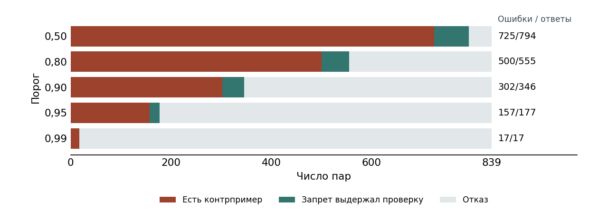
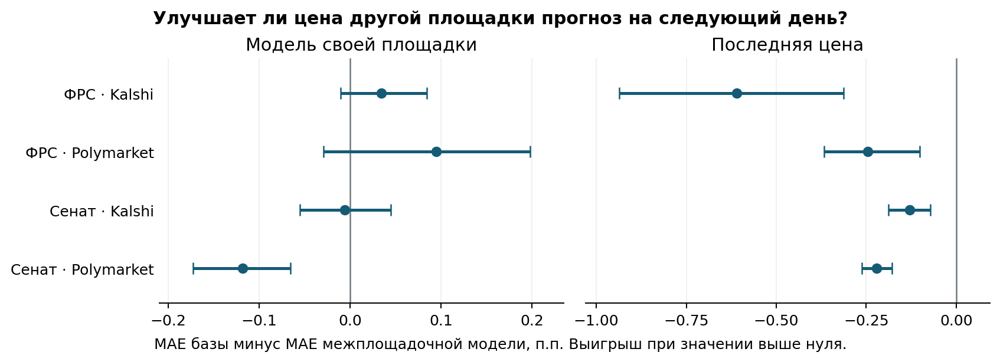

# Проверяемые связи выплат на рынках предсказаний

**Черновик выпускной квалификационной работы для обсуждения с научным руководителем**

Александр Тармаев · Университет ИТМО · ноябрь 2026

## Аннотация

Два контракта на одно событие могут различаться порогом выплаты, источником сведений или датой фиксации результата. От того, какие совместные выплаты допускают их правила, зависит интерпретация разницы цен. В работе представлен метод проверки предложенной связи через множество допустимых исходов. На разделах правил с числовыми порогами он строит конкретный пример, опровергающий ложное ограничение. На межплощадочных парах он позволяет указать, какое допущение нужно проверить до сравнения цен.

На 839 парах Kalshi при стандартном пороге преобразования оценок языковой модели в тип связи получено 555 содержательных ответов. Для 500 ответов в условной модели обычной бинарной выплаты найдено общее значение показателя, при котором запрет модели нарушается. Повышение порога до 0,99 сократило число ответов до 17, и все 17 сохранили противоречие. При сравнении рыночных цен правильный портфель порогов воспроизвёл выплаты семи корзин core CPI за три месяца. При допустимом расхождении выпусков на 0,1 процентного пункта точная репликация перестаёт быть гарантированной для каждой корзины. На семи парах рынков последнее дневное наблюдение дало меньшую ошибку прогноза цены, чем межплощадочная регрессия во всех четырёх панелях.

**Ключевые слова:** рынки предсказаний, семантика контрактов, Polymarket, Kalshi, логическое следование, отказ от решения, межплощадочные цены.

## 1. Введение

Расчёт по контракту YES определяется опубликованными правилами площадки. Название часто представляет собой сокращение. «Победит на выборах», «будет объявлен победителем» и «вступит в должность» могут описывать одну и ту же ожидаемую новость, но задавать три разных критерия расчёта. Сопоставление по названию полезно для поиска. Если же результат этого шага автоматически превращается в равенство выплат, обычная разница цен может выглядеть как гарантированный доход.

**Исследовательский вопрос.** Как часто предложенная алгоритмом связь накладывает лишнее ограничение на совместные выплаты и какими доступными проверками это можно обнаружить? Мы изучаем бинарные и условно бинарные контракты рынков предсказаний. Нас интересует, как перевод правил в ограничения между контрактами влияет на анализ цен.

В работе решаются три задачи. Сначала требуется найти кандидатов на связь и измерить, какой вклад даёт добавление контекста события. Затем нужно проверить предложенное отношение и показать цену уверенного неверного запрета. Наконец, предстоит оценить, какие утверждения о рыночных ценах и автоматическом разрешении событий позволяют сделать доступные наблюдения. Основной вклад данного этапа составляют воспроизводимая оценка риска с несколькими порогами, сценарная проверка CPI, контроль циклического подтверждения в графе и сопоставление этих результатов с наблюдаемыми ценами.

## 2. Связь с предшествующими исследованиями

Capponi, Gliozzo и Zhu строят граф связей, предложенных языковой моделью, и сравнивают знаковую корреляцию изменений цен с тематически близкими контрольными парами. В четвёртой версии использованы восемь месячных каталогов Kalshi и 30,3 млн сделок. Это способ проверить, согласуются ли направления изменений цен с найденной связью. Для верификации формулы выплаты требуется перечислить допустимые исходы конкретной пары. Например, два политических контракта могут двигаться синхронно и всё же расходиться при замене кандидата. [Capponi et al., v4](https://arxiv.org/abs/2512.02436v4)

Gebele и Matthes исследуют межплощадочную идентичность и направленное включение событий, учитывая временные рамки и правила разрешения. Их постановка объясняет, почему важно прочитать полный пакет условий. В нашем протоколе разные события могут иметь полезное строгое вложение, а отдельная ветвь договора может сделать общий вывод неопределённым. Это требует представления, которое хранит направление вложения, условия применимости и допускает частичный ответ. [Gebele и Matthes](https://arxiv.org/abs/2601.01706)

Shi и Zhai подали первую версию ближайшей по тематике работы на arXiv 16 октября. Четвёртая версия датирована 25 октября. Авторы уже используют логические типы, цитаты из правил, поиск контрпримеров, модельный аудит и оптимизацию портфеля. Они сообщают о 1,94 млн отношений, а два модельных аудитора подтвердили 102 288 из 239 653 парных предложений LLM. Эти показатели описывают масштаб и согласование процедур. Наш более узкий вопрос касается измеримой ошибки отдельного запрета, численного свидетеля, цены отказа и переноса оценки на отличающиеся правила двух площадок. [Shi и Zhai, таблицы 3–4 и приложение B](https://arxiv.org/html/2610.23517v4)

Есть также две смежные задачи. В KalshiBench Nel изучает прогнозирование уже выбранных вопросов и калибровку уверенности. Kota сравнивает способы вынести решение о факте по пакету свидетельств, включая голосование и дебаты. Поле идентификатора, дата доступности свидетельства и итоговая рекомендация подходят для разных стадий оценки. Разрешение отдельного события агентом включено в работу как прикладной контроль утечек и качества данных. [Nel](https://arxiv.org/abs/2512.16030) · [Kota](https://arxiv.org/abs/2605.30802)

## 3. Формальная модель и измеряемая ошибка

Пусть ω описывает ход события, доступные публикации источника и применимую процедуру расчёта. Контракту $i$ сопоставляется выплата $f_i(\omega)$. Для области $D$, где обе выплаты бинарны, определим множество допустимых совместных выплат

$$ S(A,B;D)=\{(f_A(\omega), f_B(\omega)) : \omega \in D\}. $$

Запись 10 означает, что контракт A выплачивает единицу, а B выплачивает ноль.

| Предложенная связь | Какое состояние запрещено | Проверка на примере |
|---|---|---|
| A влечёт B | 10 | Существует ли сценарий A=1 и B=0? |
| Эквивалентность | 01 и 10 | Совпадают ли выплаты в обе стороны? |
| Взаимоисключение | 11 | Могут ли оба контракта дать YES? |
| Исчерпываемость | 00 | Могут ли оба контракта дать NO? |
| Дополнение | 00 и 11 | Всегда ли ровно одна выплата равна единице? |

Для каждого состояния протокол допускает запрет с основанием, возможность с примером или неопределённость. Если функция зависит от особой процедуры при отмене, отсутствующая редакция правил оставляет соответствующую область неразобранной. Например, в сохранённом правиле Kalshi для ухода президента есть отдельная ветвь расчёта по последней цене или решения комитета. Присвоение бинарного исхода по умолчанию изменило бы сам объект сравнения. [Проверенный текст и область вывода](../../research/validated_findings.md)

Для предполагаемого множества запретов F ошибка пары равна единице, когда пересечение F с S непусто. Каждый элемент пересечения допускает наблюдаемый или конструктивный контрпример. **Покрытие** определяется как доля пар, на которых метод высказался. **Условный риск** равен доле высказанных ответов с хотя бы одним ложным запретом. Один ответ с двумя ошибочными запретами учитывается один раз. Полнота поиска показывает, какие релевантные пары попали в выдачу. Упущенные истинные ограничения внутри уже найденной пары требуют отдельной оценки полноты типизации. В основном NLI-аудите этот второй показатель не оценивался. Отказ убирает конкретное утверждение из графа. Риск среди оставшихся ответов нужно измерять заново при каждом пороге.

Для двух предикатов вида x > t или x ≥ t достаточно проверить оба порога, по точке внутри каждого промежутка и в обеих внешних областях. Там, где границы совпадают, дублирующиеся точки ничего не меняют. Между соседними границами значение обоих предикатов постоянно. Поэтому набор даёт полный эталон для объявленной непрерывной модели. Применение такого доказательства к конкретному договору дополнительно требует общего показателя, выпуска, единицы, правил округления и бинарной процедуры. Отдельные проверки на дискретной сетке CPI используют записанную точность публикации.

## 4. Данные и дизайн сравнения

Исследование объединяет выборки с разными единицами. Число пар используется как знаменатель только внутри соответствующей процедуры.

| Материал | Единица | Что можно оценить |
|---|---|---|
| 839 пар в 19 группах, 8 серий Kalshi | Пара пороговых контрактов из сохранённого пула NLI | Ошибку типа связи в общей скалярной модели |
| Выборка 493 × 493 контрактов | Известная авторская ссылка между площадками | Ранг среди кандидатов и изменение ранга после добавления контекста |
| 7 контрактов Polymarket × 55 Kalshi по core CPI | Полный блок из 385 комбинаций в одном срезе | Поиск одного выпуска и сценарную чувствительность числовых связей |
| 16 контрольных задач старого запуска Qwen | Пара с заранее заданным эталоном | Сопоставление процедур на искусственно определённых случаях |
| Дневные архивы и рыночные снимки | Контракт, пара и дата наблюдения | Волатильность, описательные расхождения и ошибку ретроспективного прогноза |
| Архивы исходов и ответов оракулов | Прогноз или решение по событию | Воспроизведение опубликованных ответов и аудит временной доступности |

В исходном эксперименте использован двунаправленный DeBERTa с NLI-метками entailment, contradiction и neutral. В зафиксированном преобразовании используются средняя двунаправленная оценка contradiction, оценки entailment каждого направления, порог и отрыв 0,10. Порядок выбора типов и прежние вероятности сохранены. Мы варьируем только порог и проверяем итоговые утверждения независимо от величины оценки. Повторная генерация вероятностей не нужна для этого эксперимента. [Правило отображения и входы](../../extension/nlp/score_candidate_pool.py) · [План и пересчёт](../../experiments/confidence_audit/design.md)

Для оценки неопределённости рынки одного события нельзя считать независимыми: один и тот же контракт входит в несколько пар. Поэтому отчёт показывает равновзвешенные семейства, изменения при исключении серии и результаты по отдельным событиям. Бутстрэп по небольшому числу семейств рассматривается как чувствительность оценки; формальная репрезентативность всех площадок из него не следует. Просмотренные при разработке примеры сохранены как разведочные. Для источников без независимой двойной разметки рядом с метрикой указан способ получения эталона.

## 5. Исследование ошибочных запретов

Пересечение 1188 исходных NLI-пар с 2838 пороговыми кандидатами дало 839 пар из 286 контрактов. Внутри каждой пары совпадают событие, основной текст после маскирования порога, дополнительные правила и два временных поля. Общий скаляр и нормальная процедура выплаты остаются явными допущениями. При пороге 0,80 алгоритм ответил по 555 парам, для 500 ответов найден контрпример. Число 500 складывается из 325 ложных исключений, 148 ложных эквивалентностей и 27 неверных направлений вложения. Ранее в проекте учитывали только 325 ложных исключений на все 839 пар. Новая оценка учитывает другие типы ошибок и явно показывает, что произошло на парах с ответом.

| Порог NLI | Ответов из 839 | Ответов с ошибкой | Покрытие | Риск на ответах |
|---|---:|---:|---:|---:|
| 0,50 | 794 | 725 | 94,6% | 91,3% |
| 0,80 | 555 | 500 | 66,2% | 90,1% |
| 0,90 | 346 | 302 | 41,2% | 87,3% |
| 0,95 | 177 | 157 | 21,1% | 88,7% |
| 0,99 | 17 | 17 | 2,0% | 100,0% |

При пороге 0,80 риск с равным весом каждой из восьми серий равен 90,5%. Поочерёдное исключение одной серии даёт оценки от 88,4% до 91,5%. При 0,99 остаются ответы только по трём сериям. Одна из ошибочных пар сохраняется при всех пяти порогах. В контрактах KXLCPIMAXYOY-27-P5.5 и KXLCPIMAXYOY-27-P4.5 алгоритм объявил взаимоисключение. Общее допустимое значение 6,5% превышает оба порога и даёт 11. [Результаты по каждой серии и паре](../../experiments/confidence_audit/README.md)

Ошибку может объяснять несоответствие исходной задачи NLI задаче выплат. Модель сопоставляет предложения целиком, в том числе числа и формулировки. Эвристика затем трактует противоречие между текстами как невозможность совместного YES. Рассмотренный эксперимент локализует ошибку в совокупной процедуре. Разложить её на свойства модели, токенизации и преобразования можно отдельной абляцией при фиксированных контрактах.

## 6. Межплощадочный поиск и проверка графа

### 6.1. Поиск при ограниченном бюджете просмотра

На фиксированном корпусе сравнили два представления входа E5 и BGE. Исходный файл содержит 461 пару с авторской меткой same, 27 different и 5 unsure. Для E5 добавление заголовка события увеличило долю известных положительных ссылок на первом месте с 85,81% до 98,73%, при равном весе 252 компонент событий. Приращение составило 12,92 процентного пункта, описательный 95%-й интервал парного бутстрэпа по компонентам составил от 9,75 до 16,40 п.п. На основной глубине 20 обе версии нашли все известные положительные ссылки. В выдачу с контекстом на этой глубине попали также обе ориентации всех 27 отрицательных пар. Выдача служит очередью на чтение, и её полнота зависит от того, какими положительными примерами располагает исследователь.

В дополнительном опыте мы оставили только случаи, где в целевом событии есть несколько исходов: 581 направление поиска, 292 положительные ссылки, 83 семейства. Для E5 добавление контекста дало 13,59 п.п. прироста первого места в полном каталоге и 0,30 п.п. внутри заранее указанного правильного события. Для BGE прирост составил 14,85 и 0,12 п.п. соответственно. Случайный выбор исхода внутри правильного события давал 37,67%. Таким образом, основная наблюдаемая прибавка связана с поиском события. В этой проверке событие известно из эталонной ссылки. В рабочем поиске его ещё предстоит определить. [Состав условной выборки и расчёт](../../experiments/semantic_audit/event_competition/README_RU.md)

Во втором опыте проверили, помогает ли отрыв от ближайшего конкурента отсечь ложные ссылки. Порог подбирали на остальных событийных компонентах с целевым сохранением 90% положительных примеров. У E5 порог по косинусному сходству пропустил 11 из 27 известных отрицательных пар, а порог по отрыву пропустил 15. У BGE счёт изменился с 8 до 15. Обе модели при отборе по отрыву приняли пару о выходе Half-Life 3 и о победе этой игры в номинации Game of the Year. Общая тема надёжно указывает на игру, но исходы определяются разными событиями. Двадцать семь отрицательных ссылок отобраны авторами исходного корпуса, поэтому эти доли нельзя считать частотой ошибочных связей в полном каталоге. [Сравнение мер уверенности](../../experiments/confidence_audit/linked_pairs/README_RU.md)

Для проверки на полностью перечислимом блоке взяли семь ноябрьских исходов Polymarket и 55 порогов Kalshi. При одной обычной публикации релевантны 77 из 385 комбинаций. В каждой из 77 выплат есть хотя бы одно недопустимое совместное состояние. Прежние и будущие месяцы образуют 308 контрольных комбинаций в модели свободных месячных значений. Во всех четырёх вариантах оставлены фиксированными корпус, TF–IDF и правило разрешения ничьих. В структурированном варианте дополнительно усилен вес ключа «показатель и месяц». Отдельный эффект структуры и весового коэффициента из этого контраста вывести нельзя.

| Текст для поиска | Из 77 при k=5 | Из 77 при k=20 | Точность очереди при k=20 |
|---|---:|---:|---:|
| Заголовок | 9 | 77 | 55,0% |
| Событие и исход | 9 | 77 | 55,0% |
| Доступные правила | 35 | 75 | 53,6% |
| Событие, исход и ключ показателя/месяца | 35 | 77 | 55,0% |

При бюджете пяти просмотров на запрос разница существенна для этой семьи. При двадцати исчезает преимущество над заголовком. В CPI-проверке выборка охватывает один блок и десятичную сетку 0,1 п.п. Второй сценарий разрешает площадкам использовать разные выпуски, например при задержке. В такой модели для всех 79 ранее запрещённых состояний на 77 парах нашлись свидетели. Это оценка чувствительности к предпосылке, а не 79 исторических ошибок расчёта. [Протокол и результаты](../../experiments/semantic_audit/results.json)

### 6.2. Структурированный ответ и независимость графового свидетельства

На 16 контролируемых задачах повторно оценены сохранённые ответы Qwen3-4B. При одинаковом целевом покрытии 75% состояний прямой ответ ошибочно запрещал 14,29% допустимых состояний, по которым высказался, структурированный ошибся в 15,71% случаев. Точность высказанных запретов составила соответственно 73,68% и 45,00%. При равной уверенности использовано ожидаемое число ответов при равномерном разрешении ничьей. На 15 парах, где обе процедуры полностью высказались, точный ответ по всем состояниям получен в 10 и 5 случаях. Эффект, предсказанный H2, в этом малом контроле не наблюдался. Разные форматы исходного эксперимента и синтетический эталон ограничивают перенос результата.

Графовая проверка использует остальной граф как дополнительное свидетельство. При оценке ребра его собственное предсказание удаляется. В условном пороговом корпусе фильтр поддержал 216 рёбер, из которых 30 выдержали числовую проверку. Отбор уверенных рёбер при таком же покрытии сохранил 26 корректных. Равновзвешенный прирост по сериям составил 3,33 п.п. с описательным интервалом от −0,26 до 9,70 п.п. Заранее выбранная граница полезного прироста в 5 п.п. по точечной оценке не достигнута. Граф поддержал 186 ошибочных рёбер. Совпадение нескольких выводов одного алгоритма способно воспроизводить одну систематическую ошибку в разных частях графа.

Для дополнительной проверки H3 в предложения из реальных правил внесли известные изменения. В части переноса на шесть серий осталось 28 корректных и 112 повреждённых предъявлений. Проверка дословной цитаты пропустила 98 повреждений. После сверки порога, оператора и выплаты осталось 28 пропусков. Добавление явных проверок отрицания и исключений устранило их на этой выборке. Все три процедуры сохранили 28 корректных предъявлений. Отсюда следует, что для предусмотренных изменений имеющийся проверяющий компонент различает повреждённый и исходный текст. Он был спроектирован с учётом типов порчи; независимая разметка новых договорных оговорок и бюджетно-сопоставимое сравнение с критиком LLM остаются необходимыми. [Дизайн мутаций](../../experiments/semantic_audit/MUTATION_PROTOCOL_RU.md)

## 7. Цены и исполнение

У равных бинарных выплат разница двух средних котировок описывает расхождение оценок. Чтобы превратить его в торговую нижнюю границу, на одной площадке требуется купить YES по доступному ask, на другой нужно купить NO по доступному ask. При одинаковых единичных выплатах валовая нижняя граница на комплект составляет 1 − ask(YES) − ask(NO). Из неё вычитают комиссии и расходы исполнения. Выполнимый размер ограничивает меньшая доступная глубина, а несинхронное исполнение создаёт риск второй ноги. Для направленного вложения A ⇒ B соответствующий комплект состоит из YES(B) и NO(A). Если допустимо состояние A=1, B=0, обе ноги могут дать нулевую выплату. Следовательно, ложный запрет может завысить расчётную минимальную выплату такого комплекта с нуля до единицы.

### 7.1. Контракт «ровно 0,3%» и портфель из двух порогов

Пусть BLS опубликовало месячное изменение базового индекса потребительских цен с точностью до 0,1 процентного пункта. Обозначим через T₀,₂ выплату Kalshi за значение строго выше 0,2%. В области одного и того же обычного выпуска корзину Polymarket «ровно 0,3%» воспроизводит разность T₀,₂ − T₀,₃. Если значение равно 0,3%, первый контракт даёт единицу, второй ноль. Ниже этой точки оба дают ноль, выше оба дают единицу. Для нижней крайней корзины нужна единица минус порог, для верхней достаточно соседнего порога. Покупка и продажа нескольких составляющих портфеля требуют котировки каждой нужной стороны.

В срезе 14 ноября из семи корзин у шести нашлись котировки для хотя бы одного направления обмена между корзиной и соответствующим портфелем. Три разности bid и ask до комиссий были положительными, ни одна не превысила одного цента. После подстановки сохранённых ставок комиссий максимальный расчётный результат на комплект равнялся −0,024 цента до округления сборов. На тех же исходных рынках сопоставление лишь по написанному в названии числу оставляло четыре положительных оценки после комиссий на семи доступных сравнениях. Котировки отражают разные моменты состояния книг, а глубина Polymarket отсутствует. Поэтому из этих данных можно оценить ошибку отбора кандидатов, но нельзя восстановить результат сделки.

В сентябрьском срезе одной площадки для пар вложенных порогов обнаружена 41 инверсия среди 1 027 пар с двумя наблюдаемыми средними ценами. В 1 030 сравнениях, для которых доступны bid более строгого и ask более слабого события, положительного разрыва не было. Знаменатели различаются, поскольку для сделки достаточно двух определённых сторон стакана. [Исходные срезы, формулы и результаты](../../experiments/market_audit/README_RU.md)

### 7.2. Фактические выплаты и устойчивость к различию выпусков

За август, сентябрь и октябрь фактические выплаты семи корзин сравнили с расчётами по погашенным порогам. Контракт Kalshi с тем же числом в названии расходился с выплатой Polymarket в 12 из 21 сравнения. Корректный по обычным правилам портфель воспроизвёл 21 выплату из 21. Во все три месяца показатель составил 0,3%. Повторная сверка охватывает один реализовавшийся уровень индекса. Для остальных границ нужен отдельный тест.

Отдельно проверена устойчивость к небольшому расхождению между двумя значениями, принятыми площадками. Выплаты всех семи ноябрьских корзин и обоих способов репликации перебраны по десятичной сетке, включая крайние интервалы. При общем значении правильно построенный портфель совпадает с корзиной во всех состояниях для 7 из 7 корзин. При допустимом расхождении всего на один шаг (0,1 п.п.) для каждой корзины возможна как недоплата на единицу, так и переплата на единицу. Например, если Polymarket рассчитывает корзину «0,3%» по 0,3%, а Kalshi рассчитывает пороги по 0,4%, корзина даёт единицу и разность порогов равна нулю. Это условный сценарий. Его частоту в истории рынка предстоит оценить по разновременным релизам и редакциям правил. [Перебор и свидетели для всех корзин](../../experiments/release_stress/results.json)

### 7.3. Прогноз цены на следующий день

Из двух открытых архивов взяли четыре пары рынков о выборах в Сенат США и три пары об исходах одного апрельского заседания ФРС. Для каждой площадки прогнозировали её собственную цену YES на следующий календарный день. Первая половина окна служила начальной историей, вторая была разделена на четыре последовательных блока. При переходе к очередному блоку модель обучалась заново только на уже доступных целевых ценах. Пропущенные дни не заполнялись. Проверялись четыре прогноза: последняя цена, регрессия по своему уровню и изменению, добавление изменения второй площадки, добавление также разрыва цен. Для проверки чувствительности использовали запаздывание источника на один и на семь дней, временной сдвиг при обучении и ограничения на активность котировок. Ошибка измеряется в процентных пунктах цены YES.

| Целевая площадка и рынок | Прогнозов | MAE последней цены | MAE своей регрессии | MAE полной модели |
|---|---:|---:|---:|---:|
| Kalshi, ФРС | 115 | 1,148 | 1,792 | 1,758 |
| Polymarket, ФРС | 115 | 0,683 | 1,023 | 0,929 |
| Kalshi, Сенат | 517 | 0,909 | 1,033 | 1,038 |
| Polymarket, Сенат | 506 | 0,611 | 0,713 | 0,831 |

Во всех четырёх панелях сохранение последней цены дало меньшую MAE, чем полная модель. На договорах ФРС добавление другой площадки по сравнению с регрессией только по собственной истории уменьшило ошибку на 0,034 и 0,095 п.п. Оба 95%-х интервала включают ноль. При прогнозе цены на Polymarket для Сената добавление межплощадочных признаков увеличило ошибку на 0,118 п.п. Отсутствие выигрыша на этих дневных рядах совместимо с внутридневной передачей информации. Для исходной гипотезы H5 нужны синхронизация котировок, независимая проверка версий пар и оценка возраста наблюдений. [Данные, временны́е разбиения и абляции](../../experiments/lead_lag/README_RU.md)

## 8. Разрешение рынков и контроль утечки

Для рынка с фиксированным источником полезно различать прогноз до релиза, определение исхода по публикации и официальный расчёт площадки. Эксперимент сравнивает записи только внутри их стадии. Состояние DEFER означает, что к данному времени доступных оснований недостаточно. Разделение стадий особенно важно, когда ретроспективный веб-поиск может вернуть заметку, опубликованную или изменённую после закрытия рынка.

### 8.1. Воспроизведение архивного голосования

Для 1189 строк работы Kota из авторского архива восстановлены 992 верных взвешенных голосования архитектуры A и 905 верных финальных ответов B. Это проверка файла опубликованных результатов. Измерение независимого эффекта дебатов потребовало бы повторного запуска обеих архитектур с одинаковыми свидетельствами и датами. Аудит 486 пакетов показал, что у 4821 из 4844 сохранённых источников поле text пусто. У 1024 источников отсутствует дата публикации. Пустота поля и время выгрузки допускают разные объяснения; для утверждения о конкретном ответе требуется знать, какое поле и какую версию пакета получил агент.

Чтобы проверить перенос порога принятия решения, 455 ранних строк использовали для выбора порога уверенности, 668 поздних оставили для оценки. Исключены 66 строк из 33 серий, пересекающих границу частей. На поздней части сочетание единогласия и порога 0,9167 приняло 300 из 668 решений. Среди принятых было восемь ошибок: точность 97,33%, покрытие 44,91%. Обе величины нужны для оценки маршрутизации на ручную проверку. Механизм может успешно выбирать сравнительно простые случаи. Перенос на новые правила и новые категории необходимо проверить проспективно. [Архивные и отложенные результаты](../../experiments/oracle_audit/results/kota.json)

У Nel направление вероятности влияет даже на знак вывода о преимуществе обработки. На 221 однозначно сопоставимой записи GPT-5.2-XHigh замена сохранённой вероятности на буквальное XML-значение P(YES) изменила Brier с 0,4467 до 0,2383. Для Claude на соответствующем подмножестве показатель изменился с 0,2079 до 0,3632. Меньший Brier означает меньшую среднюю квадратическую ошибку вероятности. Универсальное исправление архива по одному шаблону получило бы противоположные эффекты для этих моделей. [Аудит выходов](../../experiments/oracle_audit/results/nel.json)

### 8.2. Момент доступности и изолированный повтор

На 40 реальных котировках по четырём сочетаниям «серия и месяц» проверялось, можно ли вынести решение на материале официальных публикаций CPI. Они соответствовали всего двум датам релиза. За секунду до появления разрешённого свидетельства правило возвращало DEFER в 40 случаях из 40. На отметке релиза правило выдало 40 решений. В отдельной сверке с 12 полученными биржевыми исходами все 12 совпали; лишь девять этих контрактов имели также подходящую сохранённую котировку. Время доступности в ретроспективной таблице не измеряет сетевую задержку от публикации до решения живого сервиса. [Проверки и состав выборки](../../experiments/oracle_audit/results/cpi.json)

Тест изоляции проверял доступ к файлу и сети, отсутствие маркера окружения и влияние будущего пакета на ответ до релиза. Изменение доступного значения меняло NO на YES, а изменение ещё недоступного пакета сохраняло прежний результат. Это проверяет реализацию передачи данных из конкретного стенда. Память предобученной модели таким тестом исключить нельзя. Для этого подходят пары свежих событий со скрытой от модели развязкой, перемешивание идентификаторов в контроле и отдельная регистрация ответа до официального расчёта.

Для моделей быстрого выбора ответа рассмотрен открытый журнал Jev. На первом повторе для 400 уникальных примеров получено 384 верных ответа. Журнал относится к маршрутизации обращений. Это проверка формата решения и затрат вызова, а перенос на расчёт рынка требует отдельного корпуса. Аналогично веса инструмента, подобранные по двум выпускам CPI, не устанавливают экономически оптимальную политику. Отложенный результат оракула и время удержания капитала требуют реального журнала доступности и стоимости. [Данные Jev](../../experiments/oracle_audit/results/jev.json)

## 9. Обсуждение

Один и тот же алгоритм может успешно навести исследователя на пару и ошибиться в формулировке связи. На авторском корпусе при бюджете одного кандидата добавление названия события заметно улучшает поиск. В пороговом корпусе наблюдается другой механизм: достаточно одного числового значения, чтобы опровергнуть уверенное взаимоисключение. Эти две процедуры отвечают на разные вопросы. Высокое положение пары в выдаче служит основанием открыть оба договора. Ограничение на выплату требует отдельного основания.

Пороговый тест обладает высокой внутренней проверяемостью. Каждое опровержение можно повторить двумя подстановками. Область применимости сужают отбор повторяющихся формулировок, обычная процедура выплаты и восемь серий одной площадки. Подобранные и синтетические случаи полезны для разработки проверяющего компонента. Для оценки его поведения на новых контрактах нужно заранее зафиксировать все версии правил, единицу разбиения, критерий включения и основную метрику. Пары с недоступными условиями следует учитывать в доле отказов. Исключение этих пар из знаменателя способно заметно завысить пригодность метода для обработки всей очереди.

Для H1 разумно сохранить два бюджета просмотра. Глубина 20 соответствует исходному протоколу и на доступных известных ссылках даёт потолок. Первое место отражает стоимость ручного чтения, а случайный выбор внутри известного события показывает, какую часть работы уже выполнил отбор по событию. Для H2 и H3 нужна независимая разметка каждого из четырёх состояний, со ссылкой на редакцию и примером. Одинаковая модель, пакет документов и бюджет вызовов позволят отнести изменение ошибки к способу проверки. Погашение одного реального контракта даёт наблюдение только для одной траектории события, поэтому само по себе не размечает остальные возможные состояния.

Ценовые результаты задают границу экономической интерпретации. Три одинаковых реализации core CPI позволяют сверить бухгалтерию выплат на одном уровне индекса. Разреженный срез заявок позволяет увидеть исчезновение разрыва при переходе от средней цены к стороне, по которой требовалось бы исполнить приказ. Для нижней границы фактического дохода необходимы совпадающие время, объём и условия выплаты. Дневной прогноз собственной цены измеряет ещё одну величину. Его ошибка может расти при добавлении признаков другой площадки, даже если в отдельные часы площадки реагируют в разное время.

## 10. Заключение

Основной результат представляет собой измерение ошибочных ограничений с проверяемым для каждой пары числовым свидетелем. При пороге NLI 0,80 в 500 из 555 ответов обнаружен хотя бы один допустимый по общей скалярной модели исход, который процедура запретила. Среди 17 ответов, сохранившихся при пороге 0,99, такие свидетели нашлись для каждого. В этой задаче уверенность преобразования NLI недостаточна для автоматического принятия связи.

На межплощадочном примере проверка формулы изменила интерпретацию тех же цен: корзина «ровно 0,3%» требует двух порогов Kalshi. Правильно составленные портфели воспроизвели все наблюдаемые выплаты за три месяца. При разнице используемых площадками значений всего в 0,1 п.п. для каждой корзины уже возможен полный единичный разрыв. Это связывает семантическую ошибку с конкретной величиной риска и формулирует ближайшую полевую проверку. Наиболее важны новые семейства контрактов с версиями полных правил и независимыми заключениями двух разметчиков. Их результат позволит оценить одновременно покрытие, ошибку запретов и цену передачи сложной пары человеку.

## Основные источники

1. Capponi A., Gliozzo A., Zhu B. Agentic AI for Clustering and Relationship Discovery in Prediction Markets. arXiv, v4, 2026. [Текст](https://arxiv.org/abs/2512.02436v4)
2. Gebele J., Matthes F. Semantic Non-Fungibility and Violations of the Law of One Price in Prediction Markets. arXiv, 2026. [Текст](https://arxiv.org/abs/2601.01706v1)
3. Shi H., Zhai D. Combinatorial Arbitrage in Prediction Markets. arXiv, v4, 2026. [Текст](https://arxiv.org/abs/2610.23517v4)
4. Saguillo O., Ghafouri V., Kiffer L., Suarez-Tangil G. Unravelling the Probabilistic Forest: Arbitrage in Prediction Markets. AFT, 2025. [Текст](https://arxiv.org/abs/2508.03474)
5. Kota T. Design and Evaluation of Multi-Agent AI Oracle Systems for Prediction Market Resolution. arXiv, 2026. [Текст](https://arxiv.org/abs/2605.30802v1)
6. Nel L. Do Large Language Models Know What They Don't Know? Kalshibench: A New Benchmark for Evaluating Epistemic Calibration via Prediction Markets. arXiv, 2025. [Текст](https://arxiv.org/abs/2512.16030v1)

[Обзор и библиографическая база](literature/REVIEW_RU.md) · [Протокол поиска](literature/SEARCH_LOG_RU.md) · [Реестр гипотез и ограничений](HYPOTHESES_RU.md)

Черновик подготовлен с помощью инструментов ИИ при написании кода, анализе источников и редактировании текста. Числовые выводы сопровождаются кодом, зафиксированными входами и протоколами повторного расчёта. Окончательная редакция и утверждение интерпретации остаются за автором.
