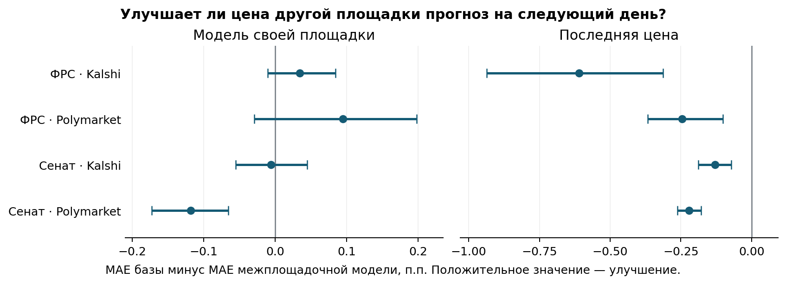

# Учитывать ли вчерашнюю цену другой площадки?

Прогнозируем цену YES на следующий календарный день отдельно для каждого договора и каждой площадки. На семи отобранных парах сохранение последней цены дало меньшую абсолютную ошибку, чем межплощадочная регрессия, во всех четырёх панелях и во всех 16 комбинациях «панель × временной блок». Такой тест оценивает добавочную информацию на дневном горизонте. Более быстрое движение цены внутри дня может исчезнуть при дневном агрегировании.

## Основной результат

MAE и разницы выражены в процентных пунктах вероятности. Четыре модели в каждой строке оценены на одних и тех же датах. В последнем столбце положительное значение означало бы преимущество полной модели перед сохранением последней цены.

| Когорта и целевая площадка | Прогнозы / даты | Последняя цена | Только своя история | + изменение другой цены | + изменение и разрыв | Последняя цена минус полная, 95% интервал |
|---|---:|---:|---:|---:|---:|---:|
| ФРС, Kalshi | 115 / 52 | 1,148 | 1,792 | 1,795 | 1,758 | −0,610 [−0,937; −0,313] |
| ФРС, Polymarket | 115 / 52 | 0,683 | 1,023 | 1,028 | 0,929 | −0,246 [−0,368; −0,102] |
| Сенат, Kalshi | 517 / 145 | 0,909 | 1,033 | 1,017 | 1,038 | −0,129 [−0,189; −0,072] |
| Сенат, Polymarket | 506 / 138 | 0,611 | 0,713 | 0,738 | 0,831 | −0,221 [−0,262; −0,178] |

Относительно обученной модели своей площадки полная модель на ФРС улучшила MAE на 0,034 и 0,095 п.п. Оба парных интервала включают ноль. Для Сената в направлении Polymarket MAE выросла на 0,118 п.п. (интервал изменения ошибки от +0,065 до +0,173). На 165 прогнозах Сената для Kalshi, когда обе цены сдвинулись в день формирования прогноза, добавление второй площадки улучшило MAE на 0,083 п.п. относительно модели одной площадки. Сохранение последней цены и здесь даёт 1,112 против 1,240 п.п. у полной модели. Подвыборка разведочная, поправка на множественные сравнения не применялась.



## Что измерялось

- Четыре гонки в Сенат США 2026 года, выбранные по доступности истории обеих площадок. Договоры о победе демократов в Джорджии, Канзасе, Мэне, Техасе. В этом же порядке Polymarket market ID `630692, 630746, 630772, 630963`; Kalshi `SENATE{GA,KS,ME,TX}-26-D`. Интервал 01.01–02.11.2026 заканчивается до дня выборов. Для Kalshi берём `price_close` только при положительном объёме за день, для Polymarket — цену YES из дневной истории CLOB. Исходный архив присваивает Kalshi дату UTC окончания свечи минус одну секунду, Polymarket — дату UTC последнего доступного ценового наблюдения. У часов и типов цен разные свойства. [Архив](https://github.com/shawnpattersonjr/prediction-markets-archive/tree/fe1f084b27695dba1725724f97f60e4c5b06b019) и [агрегирование](https://github.com/shawnpattersonjr/prediction-markets-archive/blob/fe1f084b27695dba1725724f97f60e4c5b06b019/elections/history.py).
- Три договора одного заседания FOMC в апреле 2026 года — без изменения ставки, снижение на 25 б.п., снижение на 50 б.п. или больше. Тикеры Kalshi `KXFEDDECISION-26APR-H0`, `-C25`, `-C26`. Окно 03.12.2025–28.04.2026. Используются опубликованные дневные ряды пар: последнее наблюдение UTC за день, Kalshi `price_close` с подстановкой доступной средней котировки при отсутствии цены. Напечатанный `basis` проверяется тождеством `polymarket_yes − kalshi_yes`. Исходный набор не позволяет разделить эти подстановки по строкам. [Контракты](https://github.com/aj80457/prediction-markets-arb/blob/7b33be919ea7e28a975b39c6a9fd66f6ffda2cd6/src/matching.py) и [агрегирование](https://github.com/aj80457/prediction-markets-arb/blob/7b33be919ea7e28a975b39c6a9fd66f6ffda2cd6/src/run.py).
- Цель обучаемых моделей — изменение собственной цены между днями *t* и *t+1*. Обычная линейная регрессия с константой использует уровень и однодневное изменение собственной цены. Третья модель добавляет однодневное изменение цены второй площадки, четвёртая — также межплощадочный разрыв уровней на дату *t*. Итоговую цену ограничиваем диапазоном [0,1]. Реальный исход не используется ни как признак, ни как целевая переменная.
- Первая половина календарного окна формирует исходную историю, вторая разбита на четыре последовательных блока по календарю. До начала каждого блока регрессия заново обучается на всех доступных более ранних целях. Последняя обучающая метка не позднее первой точки выдачи прогноза. Отсутствующие дни оставлены пустыми. Строка входит в анализ только при наличии цен, необходимых для признаков и метки. Модели не перевзвешивают контракты для выравнивания их представленности, поэтому эффект относится к среднему прогнозу в доступной панели.
- Парные 95%-е интервалы получены на фиксированных вневыборочных прогнозах круговой выборкой семидневных календарных блоков (2 000 повторов). Все контракты одной даты берутся совместно. Случайное зерно `49871`. Интервалы условны на эти контракты, окна и оценённые модели. Три исхода ФРС относятся к одному решению, а четыре выборные гонки имеют общий календарь. Сумма 1 253 строк включает два направления прогнозирования и зависимые даты.
- Задержки второго источника на 1 и 7 календарных дней сравниваются с текущим источником на точном пересечении обучающих и тестовых строк внутри варианта. Преимущество текущей цены непостоянно. Дополнительно записаны результаты для дней с изменением обеих цен и для дневного Kalshi-спреда до 1 п.п. Отдельный контроль циклически сдвигает историю второй площадки только в обучающей выборке (199 повторов, сдвиг в наблюдениях). Его распределение служит диагностикой соответствия временных рядов, а полноценным рандомизированным тестом причинности послужить не может.

## Воспроизведение

Из корня репозитория. Версии численного прогона — Python 3.11.8, NumPy 2.0.0, pandas 2.2.2. Для рисунка отдельно проверен Matplotlib 3.10.7 с Python 3.13.4. По умолчанию скрипт пополняет кэш по публичным адресам `raw.githubusercontent.com`; у каждого из 11 файлов проверяются SHA-256 и Git blob SHA-1 из [манифеста](sources.json). В обоих исходных репозиториях на зафиксированных ревизиях отсутствует корневой файл LICENSE; сырой сторонний архив хранится в локальном кэше `sources/lead_lag/`. Публичный комплект включает код, контрольные суммы, рисунок и агрегированные результаты. Для автономной копии заранее требуется этот кэш.

```bash
python3 -m pip install numpy==2.0.0 pandas==2.2.2
python3 experiments/lead_lag/run.py
python3 experiments/lead_lag/run.py --offline --output /tmp/lead-lag-replay
python3 -m unittest discover -s experiments/lead_lag -v
```

```bash
python3 -m pip install matplotlib==3.10.7
python3 experiments/lead_lag/plot.py
```

[Основные метрики](results/forecast_metrics.csv), [контракты](results/contract_metrics.csv), [блоки](results/fold_metrics.csv), [границы и размеры выборок](results/fold_dates.csv), [задержки](results/delay_sensitivity.csv), [сдвиг истории](results/placebo.csv), [расхождения цен и доли неизменившихся котировок](results/price_descriptives.csv). Отбор удобных архивов и оценка после завершения событий ограничивают переносимость результата. На этих данных нельзя определить внутридневную очередность обновления или доход от сделки.

При оформлении единиц наблюдения, зависимых измерений и интервалов использованы методические материалы T. Kassis, V. Agarwal, Y. He, D. Patel и A. M. Brueckner (2026). [Scientific Agent Skills: A Library of Procedural Knowledge for Research Agents](https://doi.org/10.48550/arXiv.2609.00065).
